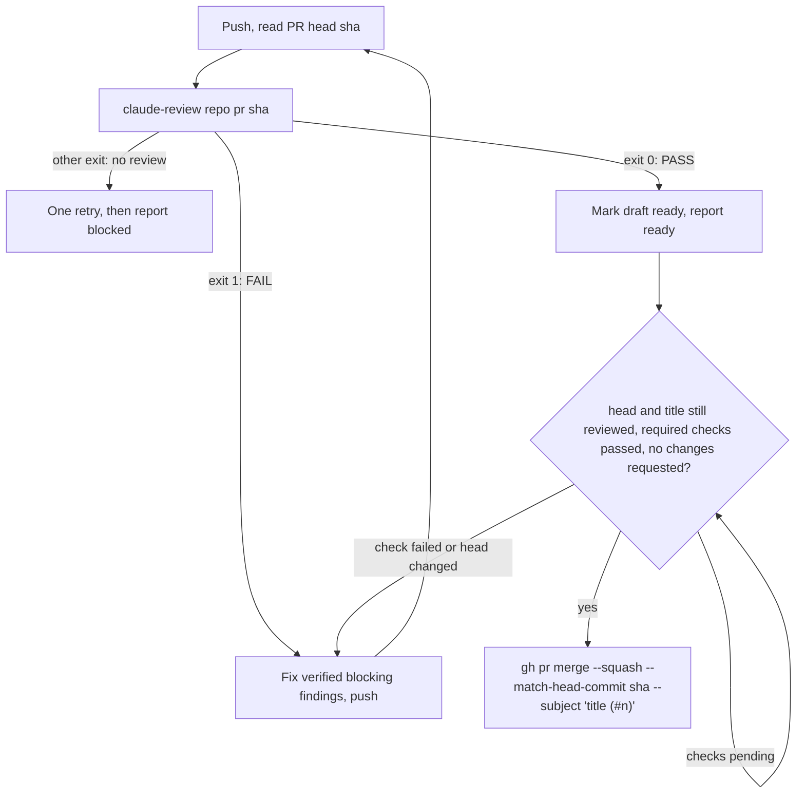

# DSH Superagent on Coolify

> Unofficial integration. This specifically targets Coolify's **Caddy**
> reverse proxy. Traefik labels are different.

## Architecture

```
Browser (HTTPS)
  -> Coolify Caddy proxy :443
    -> dashboard (internal Caddy :8080)
       -> superagent:3083 (socat tunnel to DSH 127.0.0.1:3082)
```

Access is authenticated by DSH itself: the launch-token URL that DSH prints in
the container log mints a signed, `HttpOnly`, `SameSite=Strict` session cookie
(valid 30 days, kept across restarts). Without it the DSH UI and its `/api`
answer 401.

The Superagent management API (`/orchestrator/api/*`) performs no
authentication of its own: it only accepts `Host: 127.0.0.1:3082` or
`localhost:3082` and no foreign `Origin`, trusting that only local processes
reach it. The inner proxy rewrites those headers so the browser panel works,
and therefore must authenticate those requests itself. Before forwarding, it
asks DSH whether the request carries a valid session cookie (`forward_auth`
to `GET /`, which DSH answers with 200 or 401), and it rejects cross-site
requests by their `Sec-Fetch-Site` header. Other DSH UI traffic keeps the
public Host, which `--trusted-host` allows.

## 1. Configure Coolify

Create a Git-backed Docker Compose Application referencing `compose.yaml`.
Keep Compose deployment in **normal/managed mode**, not Raw, so Coolify can
connect the dashboard service to its proxy and generate the Caddy route.

In Coolify **Domains**, assign **one** HTTPS domain, e.g. `https://superagent.example.com`,
to the **`dashboard`** service on **internal port `8080`**, or let Coolify
generate one from its wildcard domain. Do **not** attach the domain to
`superagent`. `compose.yaml` declares `SERVICE_URL_DASHBOARD_8080` on the
dashboard (the suffix selects port 8080), and Coolify derives
`SERVICE_URL_DASHBOARD` (for `--public-url`) and `SERVICE_FQDN_DASHBOARD`
(for `--trusted-host`) from its domain, so there is nothing to keep in sync.
After the first deploy, check under **Environment Variables** that
`SERVICE_FQDN_DASHBOARD` is the bare hostname: older Coolify
versions include the scheme there, which DSH refuses at startup
(`trustedHosts entry … is not a bare host[:port] authority`).

Configure Environment Variables:

| Variable | Description |
| --- | --- |
| `DEEPSEEK_API_KEY` | Model provider secret (runtime only) |
| `GH_TOKEN` | GitHub classic PAT for dedicated agent account (runtime only) |
| `GITHUB_REPOSITORY` | e.g. `ForkbombEu/credimi-attestbook` |
| `ANTHROPIC_API_KEY` or `CLAUDE_CODE_OAUTH_TOKEN` | Claude Code credential for the PR reviewer (runtime only); set one. The subscription token comes from `claude setup-token` |
| `SUPERAGENT_REVIEWER_MODEL` | Optional. Claude Code reviewer model: an alias such as `opus` or `sonnet`, or a full model id; empty uses Claude Code's default for the account |
| `SUPERAGENT_REVIEWER_EFFORT` | Optional. Claude Code reviewer effort: `low`, `medium`, `high`, `xhigh` or `max`; empty uses Claude Code's default (`high`) |
| `SUPERAGENT_GITHUB_ALLOWED_USERS` | Optional. GitHub logins that may ask for work, comma- or space-separated, e.g. `matteo-cristino` |
| `SUPERAGENT_EXECUTOR_PROVIDER` | Optional. Executor model provider id, e.g. `deepseek-official` |
| `SUPERAGENT_EXECUTOR_MODEL` | Optional, required with the provider. Executor model id, e.g. `deepseek-flash` |
| `SUPERAGENT_EXECUTOR_REASONING_EFFORT` | Optional. Executor reasoning effort; empty uses the model default |
| `SUPERAGENT_MAX_WORKERS` | Optional. Tickets worked on at the same time, 1–16 (panel default 3) |

Provider and model ids are the ones the panel's model fields accept; the
panel shows the DSH default as `provider / model`.

**Security**: whoever can read the container log can read the launch-token
URL and open the UI. The DSH workers execute code and have repository
credentials. Do not directly publish 3082, 3083 or 8080.

## 2. Deploy, validate and open

Deploy the app from Coolify. When Caddy routes are ready:

```bash
# All must be HTTP 401 without the DSH session cookie:
curl -I https://superagent.example.com/
curl -i -H 'x-orchestrator-request: 1' https://superagent.example.com/orchestrator/api/state
curl -i -X POST -H 'content-type: application/json' -d '{}' https://superagent.example.com/api/session/list
```

A 403 from the last request means DSH does not trust the Host: open the
dashboard through its Coolify domain, and redeploy after changing that domain.

Open the launch URL from the `superagent` service log in Coolify, e.g.

```
dsh web: https://superagent.example.com/?token=...
```

DSH sets the session cookie and redirects to `/`. The token changes on every
restart, but the cookie stays valid, so the log URL is only needed for a new
browser or after 30 days.

## 3. Superagent configuration

On every start, `scripts/superagent-configure` waits for DSH and saves these
settings through the management API, so a new deployment starts configured:

| Setting | Value |
| --- | --- |
| Sources > GitHub > Repository | `$GITHUB_REPOSITORY` |
| Sources > GitHub > Agent GitHub CLI | `/usr/local/bin/gh-agent` |
| Eval > On each Source > GitHub accounts that may originate work | `$SUPERAGENT_GITHUB_ALLOWED_USERS`, when set |
| Execution > Executor model | `$SUPERAGENT_EXECUTOR_PROVIDER`, `$SUPERAGENT_EXECUTOR_MODEL`, `$SUPERAGENT_EXECUTOR_REASONING_EFFORT`, when set |
| Execution > Concurrent Tickets | `$SUPERAGENT_MAX_WORKERS`, when set |
| Execution > Prepare command | `/usr/local/bin/prepare-worktree.sh` |
| Prompts > Delivery requirements | [`prompts/delivery.md`](prompts/delivery.md): the Claude Code review and merge procedure below |

These values win over panel edits: change them in Coolify and redeploy. An
unset optional variable leaves its setting to the panel. The Ticket directory
root stays empty, which already means `/home/agent/.dsh/state/superagent/work`.
The script logs each save, or the reason a save was refused, with the
prefix `superagent-configure:` in the `superagent` service log.

Configure the rest in the panel: prompts and a review
policy appropriate for your project. Default proactive accept mode `observe`
still accepts explicit requests from allowlisted users; don't enable automatic
inferred work prematurely.

## 4. Claude Code review and automatic merge

DeepSeek implements and opens the PR as the agent account. Before merging, the
DeepSeek worker runs [`claude-review`](scripts/claude-review) on the PR's exact
head commit, then follows [`prompts/delivery.md`](prompts/delivery.md):



`claude-review` is a command rather than DSH's official Claude Code subagent
tool because dsh-superagent limits its workers to a fixed list of tools
(`WORK_TOOLS` in its `src/app/sessions.ts`), which hides that tool from them.
The command:

- checks that the sha is both the PR's head on GitHub and the checked-out
  commit, and reads the PR's title and base branch itself;
- runs the Claude Code CLI (`@anthropic-ai/claude-code`, installed in the
  image) with the fixed review task in
  [`claude-code/review-prompt.md`](claude-code/review-prompt.md), so DeepSeek
  cannot change what Claude is asked or conclude for it;
- accepts only an answer ending in `VERDICT: PASS|FAIL` and
  `REVIEWED_SHA: <that sha>`, posts it verbatim on the PR as a
  `**Claude Code review** of <sha>` comment, the record of each round, and
  exits 0 for PASS, 1 for FAIL, 2 when there is no usable review (nothing
  posted, for example a timeout after 30 minutes) and 3 when the comment could
  not be posted;
- reads the Claude credential, `SUPERAGENT_REVIEWER_MODEL` and
  `SUPERAGENT_REVIEWER_EFFORT` from `/run/superagent-secrets/claude-review.json`,
  which the entrypoint writes to the container's tmpfs: DSH strips variables
  named `*_KEY`/`*_TOKEN` from worker shells.
- Commit messages and PR titles follow
  [Conventional Commits](https://www.conventionalcommits.org/en/v1.0.0/).
  Claude Code blocks a PR whose title does not, and only notes a
  non-conforming commit message: the squash commit on the base branch takes
  its subject from the reviewed title.
- Each PR description names the issues it resolves with `Closes #<n>`, so
  GitHub closes them when the PR merges; an issue a PR only advances gets
  `Refs #<n>` and stays open.
- **Issues run in dependency order without a person.** An issue lists its
  prerequisites on one line of its description, `Depends on #<a>, #<b>`. Its
  worker checks them first; if any is not closed as completed, it changes
  nothing and reports blocked with `Waiting for dependencies: …`. After each
  merge the worker reports ready, and on every ready report the main Session
  retries each waiting ticket whose prerequisites are now all closed
  (`orchestrator_ticket_retry`). Issues with no open prerequisites run in
  parallel, up to `SUPERAGENT_MAX_WORKERS`. Each issue must mention
  `@forkboteu` and be opened by an allowed account, so that it becomes a
  Ticket; it must not ask to wait for a person.
- At most three failing reviews per PR; then the worker reports blocked and
  leaves the PR unmerged. It never uses `--admin`, auto-merge, or changes
  branch protection; a merge GitHub refuses is reported, not retried.
- Claude Code runs in the worker's Ticket directory with
  `--permission-mode dontAsk` and the managed policy
  [`claude-code/managed-settings.json`](claude-code/managed-settings.json),
  installed as `/etc/claude-code/managed-settings.json`: it may read files and
  run read-only `git` commands only, and the repository's own `.claude/`
  settings, hooks and MCP servers cannot widen that.
- The merge uses the agent account's existing `gh`, so the account needs
  merge rights. Enable squash merging in the repository, and require status
  checks in branch protection for the CI gate to mean anything; do not require
  approving reviews, which the agent account cannot give itself.
- These are prompt instructions to the DeepSeek worker, not a guarantee
  enforced by code: the worker could merge without a review. Branch protection
  is the enforced part (CI, no force pushes to the base branch).

### Target repository setup

Start each repository the deployment works on from
[`templates/AGENTS.md`](templates/AGENTS.md): copy it to the repository root
and fill in its **Project** section. It states the merge, commit and
pull-request rules above, which the repository's own instructions must not
contradict, and how to write issues so they run without a person (the
`@forkboteu` mention, one PR per issue, `Depends on` lines, no holds). To fill
a backlog, ask any coding agent to read that `AGENTS.md` and
`docs/specification.md` and open the issues, with your `gh` account.

One deployment works on one repository (`GITHUB_REPOSITORY`); use a separate
Coolify application for each further repository.

## 5. Operational notes and limitations

- Keep existing service name `superagent` and volume `superagent_home` when
  migrating from the previous package. Docker Compose/Coolify may still
  rename/prefix volume names; **confirm the deployed volume before migration**.
- `superagent:3083` exists on the internal Compose network only. The outer
  Coolify Caddy proxy should route only to `dashboard:8080`.
- DSH itself uses `--public-url` and `--trusted-host` to support the external
  URL. If your pinned DSH CLI version does not recognize those flags, you may
  need to upgrade its version rather than removing the host security check.
- The management API's loopback check is intentionally rewritten by the inner
  proxy, which checks the DSH session cookie instead. A service connected to
  the same internal Docker network can still reach `superagent:3083` directly
  and bypass that check; isolate the deployment from untrusted containers.
- The image build caches npm/pnpm downloads in BuildKit cache mounts on the
  build server. Keep **Advanced > Build cache** on **Use Docker build cache**:
  "Rebuild from scratch" / "Force deploy (without cache)" skip both the layer
  cache and these mounts. Unchanged layers (apt, `dsh` install) are reused
  entirely; the cache mounts speed up the `dsh` install when its layer reruns.
  Because the upstream clone layer is cached too, use a forced rebuild to pick
  up new `dsh-superagent-prototype` commits on `main`.

References:
- https://coolify.io/docs/applications/builds/docker-compose
- https://github.com/deepseek-ai/dsh-superagent-prototype/blob/main/src/app/http.ts
- https://github.com/deepseek-ai/deepseek-harness/blob/master/docs/user/guide/public-deployments.md
