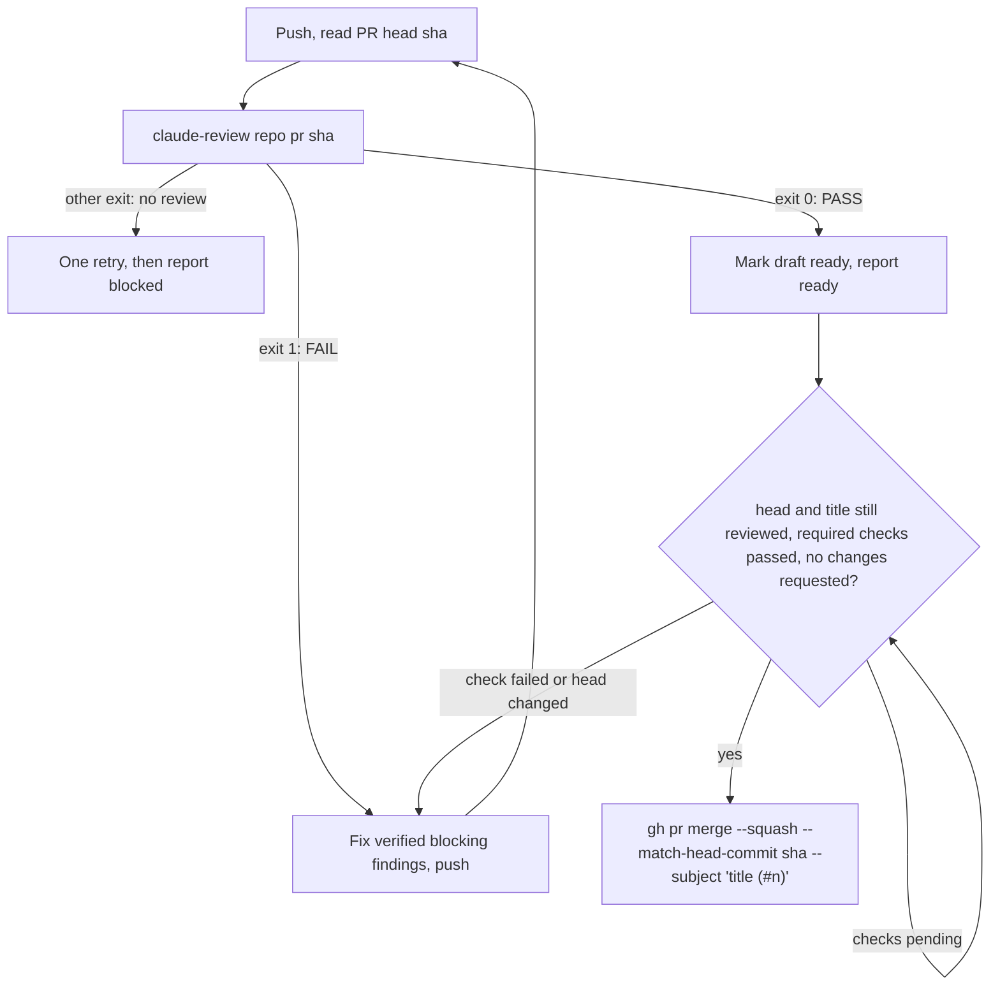
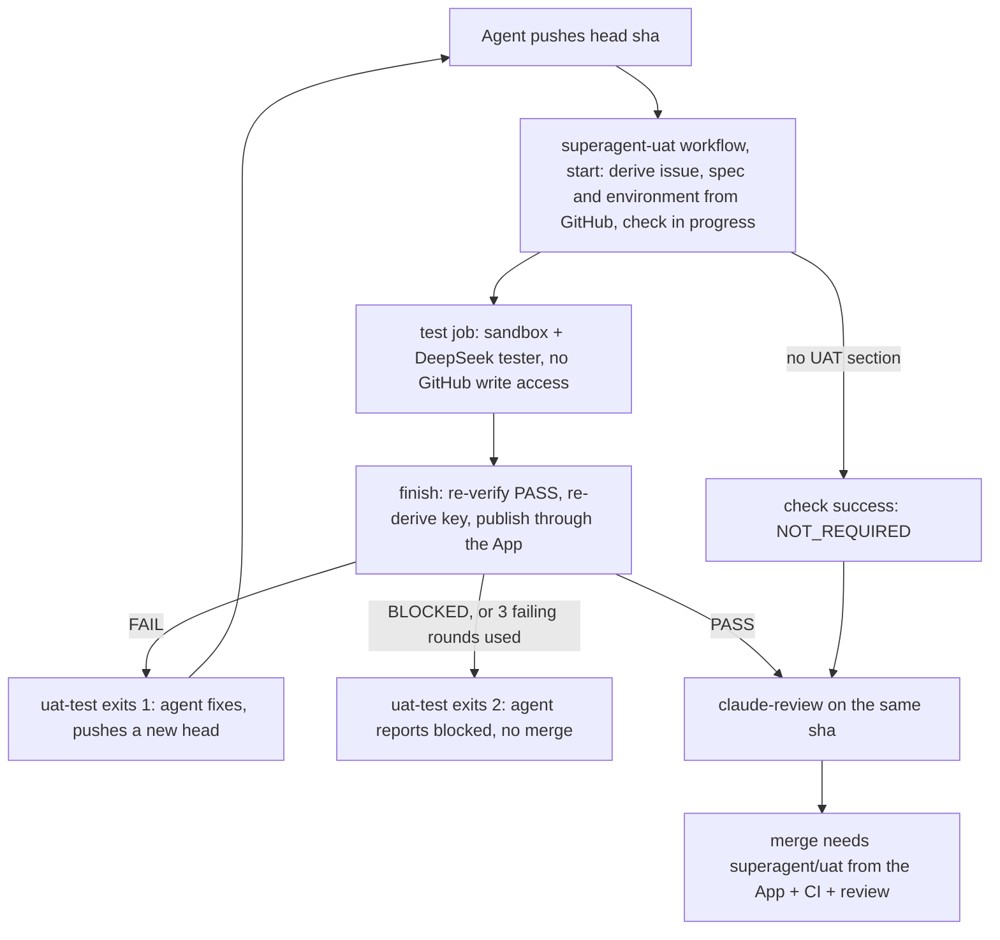

# DSH Superagent on Coolify

> Unofficial integration. This specifically targets Coolify's **Caddy**
> reverse proxy. Traefik labels are different.

## Architecture

```
Browser (HTTPS)
  -> Coolify Caddy proxy :443
    -> dashboard (internal Caddy :8080)
       -> superagent:3083 (socat tunnel to DSH 127.0.0.1:3082)
```

Access is authenticated by DSH itself: the launch-token URL that DSH prints in
the container log mints a signed, `HttpOnly`, `SameSite=Strict` session cookie
(valid 30 days, kept across restarts). Without it the DSH UI and its `/api`
answer 401.

The Superagent management API (`/orchestrator/api/*`) performs no
authentication of its own: it only accepts `Host: 127.0.0.1:3082` or
`localhost:3082` and no foreign `Origin`, trusting that only local processes
reach it. The inner proxy rewrites those headers so the browser panel works,
and therefore must authenticate those requests itself. Before forwarding, it
asks DSH whether the request carries a valid session cookie (`forward_auth`
to `GET /`, which DSH answers with 200 or 401), and it rejects cross-site
requests by their `Sec-Fetch-Site` header. Other DSH UI traffic keeps the
public Host, which `--trusted-host` allows.

## 1. Configure Coolify

Create a Git-backed Docker Compose Application referencing `compose.yaml`.
Keep Compose deployment in **normal/managed mode**, not Raw, so Coolify can
connect the dashboard service to its proxy and generate the Caddy route.

In Coolify **Domains**, assign **one** HTTPS domain, e.g. `https://superagent.example.com`,
to the **`dashboard`** service on **internal port `8080`**, or let Coolify
generate one from its wildcard domain. Do **not** attach the domain to
`superagent`. `compose.yaml` declares `SERVICE_URL_DASHBOARD_8080` on the
dashboard (the suffix selects port 8080), and Coolify derives
`SERVICE_URL_DASHBOARD` (for `--public-url`) and `SERVICE_FQDN_DASHBOARD`
(for `--trusted-host`) from its domain, so there is nothing to keep in sync.
After the first deploy, check under **Environment Variables** that
`SERVICE_FQDN_DASHBOARD` is the bare hostname: older Coolify
versions include the scheme there, which DSH refuses at startup
(`trustedHosts entry … is not a bare host[:port] authority`).

Configure Environment Variables:

| Variable | Description |
| --- | --- |
| `DEEPSEEK_API_KEY` | Model provider secret (runtime only) |
| `GH_TOKEN` | GitHub classic PAT for dedicated agent account (runtime only) |
| `GITHUB_REPOSITORY` | e.g. `ForkbombEu/credimi-attestbook` |
| `ANTHROPIC_API_KEY` or `CLAUDE_CODE_OAUTH_TOKEN` | Claude Code credential for the PR reviewer (runtime only); set one. The subscription token comes from `claude setup-token` |
| `SUPERAGENT_REVIEWER_MODEL` | Optional. Claude Code reviewer model: an alias such as `opus` or `sonnet`, or a full model id; empty uses Claude Code's default for the account |
| `SUPERAGENT_REVIEWER_EFFORT` | Optional. Claude Code reviewer effort: `low`, `medium`, `high`, `xhigh` or `max`; empty uses Claude Code's default (`high`) |
| `SUPERAGENT_UAT_APP_ID` | Optional. Turns on [user acceptance tests](#5-user-acceptance-tests): the numeric id of the GitHub App that publishes `superagent/uat` from the target repository's workflow. Not a secret; the App's private key never goes in this deployment |
| `SUPERAGENT_GITHUB_ALLOWED_USERS` | Optional. GitHub logins that may ask for work, comma- or space-separated, e.g. `matteo-cristino` |
| `SUPERAGENT_EXECUTOR_PROVIDER` | Optional. Executor model provider id, e.g. `deepseek-official` |
| `SUPERAGENT_EXECUTOR_MODEL` | Optional, required with the provider. Executor model id, e.g. `deepseek-flash` |
| `SUPERAGENT_EXECUTOR_REASONING_EFFORT` | Optional. Executor reasoning effort; empty uses the model default |
| `SUPERAGENT_MAX_WORKERS` | Optional. Tickets worked on at the same time, 1–16 (panel default 3) |

Provider and model ids are the ones the panel's model fields accept; the
panel shows the DSH default as `provider / model`.

**Security**: whoever can read the container log can read the launch-token
URL and open the UI. The DSH workers execute code and have repository
credentials. Do not directly publish 3082, 3083 or 8080.

## 2. Deploy, validate and open

Deploy the app from Coolify. When Caddy routes are ready:

```bash
# All must be HTTP 401 without the DSH session cookie:
curl -I https://superagent.example.com/
curl -i -H 'x-orchestrator-request: 1' https://superagent.example.com/orchestrator/api/state
curl -i -X POST -H 'content-type: application/json' -d '{}' https://superagent.example.com/api/session/list
```

A 403 from the last request means DSH does not trust the Host: open the
dashboard through its Coolify domain, and redeploy after changing that domain.

Open the launch URL from the `superagent` service log in Coolify, e.g.

```
dsh web: https://superagent.example.com/?token=...
```

DSH sets the session cookie and redirects to `/`. The token changes on every
restart, but the cookie stays valid, so the log URL is only needed for a new
browser or after 30 days.

## 3. Superagent configuration

On every start, `scripts/superagent-configure` waits for DSH and saves these
settings through the management API, so a new deployment starts configured:

| Setting | Value |
| --- | --- |
| Sources > GitHub > Repository | `$GITHUB_REPOSITORY` |
| Sources > GitHub > Agent GitHub CLI | `/usr/local/bin/gh-agent` |
| Eval > On each Source > GitHub accounts that may originate work | `$SUPERAGENT_GITHUB_ALLOWED_USERS`, when set |
| Execution > Executor model | `$SUPERAGENT_EXECUTOR_PROVIDER`, `$SUPERAGENT_EXECUTOR_MODEL`, `$SUPERAGENT_EXECUTOR_REASONING_EFFORT`, when set |
| Execution > Concurrent Tickets | `$SUPERAGENT_MAX_WORKERS`, when set |
| Execution > Prepare command | `/usr/local/bin/prepare-worktree.sh` |
| Prompts > Delivery requirements | [`prompts/delivery.md`](prompts/delivery.md): the Claude Code review and merge procedure below, followed by [`prompts/delivery-uat.md`](prompts/delivery-uat.md) when `SUPERAGENT_UAT_APP_ID` is set |

These values win over panel edits: change them in Coolify and redeploy. An
unset optional variable leaves its setting to the panel. The Ticket directory
root stays empty, which already means `/home/agent/.dsh/state/superagent/work`.
The script logs each save, or the reason a save was refused, with the
prefix `superagent-configure:` in the `superagent` service log.

Configure the rest in the panel: prompts and a review
policy appropriate for your project. Default proactive accept mode `observe`
still accepts explicit requests from allowlisted users; don't enable automatic
inferred work prematurely.

## 4. Claude Code review and automatic merge

DeepSeek implements and opens the PR as the agent account. Before merging, the
DeepSeek worker runs [`claude-review`](scripts/claude-review) on the PR's exact
head commit, then follows [`prompts/delivery.md`](prompts/delivery.md):



`claude-review` is a command rather than DSH's official Claude Code subagent
tool because dsh-superagent limits its workers to a fixed list of tools
(`WORK_TOOLS` in its `src/app/sessions.ts`), which hides that tool from them.
The command:

- checks that the sha is both the PR's head on GitHub and the checked-out
  commit, and reads the PR's title and base branch itself;
- runs the Claude Code CLI (`@anthropic-ai/claude-code`, installed in the
  image) with the fixed review task in
  [`claude-code/review-prompt.md`](claude-code/review-prompt.md), so DeepSeek
  cannot change what Claude is asked or conclude for it;
- gives Claude this PR's earlier reviews: every summary, and the latest review
  in full with its fix plan. Claude first re-checks the earlier blocking
  findings. A later round may only block on an unresolved finding, a problem
  the new changes introduced, a failing check, or a security, data-loss or
  correctness defect that can actually be triggered, and a recurring kind of
  problem gets one structural fix instead of another patch;
- accepts only an answer ending in `VERDICT: PASS|FAIL` and
  `REVIEWED_SHA: <that sha>`, with a Summary, a Review and a Fix plan written
  for DeepSeek (files, code sketches, tests with expected results, commands to
  run). It posts only the Summary on the PR, as a
  `**Claude Code review** of <sha>: PASS|FAIL` comment, the record of each
  round, and keeps the whole answer in the volume under
  `~/.local/state/claude-review/<owner>/<repo>/pr-<n>/`, as the worker's input
  and the next review's history;
- exits 0 for PASS, 1 for FAIL, 2 when there is no usable review (nothing
  posted, for example a timeout after 30 minutes) and 3 when the comment could
  not be posted;
- reads the Claude credential, `SUPERAGENT_REVIEWER_MODEL` and
  `SUPERAGENT_REVIEWER_EFFORT` from `/run/superagent-secrets/claude-review.json`,
  which the entrypoint writes to the container's tmpfs: DSH strips variables
  named `*_KEY`/`*_TOKEN` from worker shells.
- Commit messages and PR titles follow
  [Conventional Commits](https://www.conventionalcommits.org/en/v1.0.0/).
  Claude Code blocks a PR whose title does not, and only notes a
  non-conforming commit message: the squash commit on the base branch takes
  its subject from the reviewed title.
- Each PR description names the issues it resolves with `Closes #<n>`, so
  GitHub closes them when the PR merges; an issue a PR only advances gets
  `Refs #<n>` and stays open.
- **Issues run in dependency order without a person.** An issue lists its
  prerequisites on one line of its description, `Depends on #<a>, #<b>`. Its
  worker checks them first; if any is not closed as completed, it changes
  nothing and reports blocked with `Waiting for dependencies: …`.
  [`superagent-dependencies`](scripts/superagent-dependencies), started by the
  entrypoint, checks such tickets every minute and retries each one, as the
  panel's **Retry** does, once all the issues it waits for are closed as
  completed. It reads issue states from GitHub itself, so no worker or main
  Session message is needed after a merge. It retries a ticket at most three
  times, and logs (with the prefix `superagent-dependencies:`) a ticket that
  waits for an issue closed as not planned. Issues with no open prerequisites
  run in parallel, up to `SUPERAGENT_MAX_WORKERS`. Each issue must mention
  `@forkboteu` and be opened by an allowed account, so that it becomes a
  Ticket; it must not ask to wait for a person.
- At most three failing reviews per PR; then the worker reports blocked and
  leaves the PR unmerged. It never uses `--admin`, auto-merge, or changes
  branch protection; a merge GitHub refuses is reported, not retried.
- Claude Code runs in a temporary checkout of the reviewed commit, deleted
  afterwards, with `--permission-mode dontAsk` and the managed policy
  [`claude-code/managed-settings.json`](claude-code/managed-settings.json),
  installed as `/etc/claude-code/managed-settings.json`. It may read files, run
  read-only `git` and inspection commands, install dependencies and run tests,
  type checks and builds (`npm`, `npx`, `node`, `pnpm`, `bun`, `mise`, `make`,
  `pytest`), and read the PR, issues and CI runs with read-only `gh`
  subcommands. File edits, `git commit`/`push`, `gh api` and every `gh`
  subcommand that writes are denied, and the repository's own `.claude/`
  settings, hooks and MCP servers cannot widen that. Running the PR's tests
  runs the PR's code with the agent account's credentials available, as the
  DeepSeek worker already does: the `gh` limits stop Claude from writing, not
  code it executes.
- The merge uses the agent account's existing `gh`, so the account needs
  merge rights. Enable squash merging in the repository, and require status
  checks in branch protection for the CI gate to mean anything; do not require
  approving reviews, which the agent account cannot give itself.
- **Toolchains come from the repository's `mise.toml`.** The image ships
  [mise](https://mise.jdx.dev/) instead of fixed runtimes. The prepare command
  runs `mise install` in every new Ticket directory and `claude-review` in every
  review checkout, so the worker and Claude Code use the versions the
  repository pins (for example Bun and Node); mise's shims come first on
  `PATH`. Outside such a repository, `node` is the image's own. Installed
  versions stay in the `superagent_home` volume. Tool versions apply in any
  directory; mise runs a `mise.toml`'s `[env]`, tasks and hooks only in the
  Ticket directories, the repository checkout and the review checkouts.
- These are prompt instructions to the DeepSeek worker, not a guarantee
  enforced by code: the worker could merge without a review. Branch protection
  is the enforced part (CI, no force pushes to the base branch, and, with
  [user acceptance tests](#5-user-acceptance-tests), the `superagent/uat` check
  that only the UAT GitHub App can publish). The Claude Code review stays a
  prompt-enforced step: its PR comment is written with the agent's own token,
  so it is a record, not a security gate.

### Target repository setup

Start each repository the deployment works on from
[`templates/AGENTS.md`](templates/AGENTS.md): copy it to the repository root
and fill in its **Project** section. It states the merge, commit and
pull-request rules above, which the repository's own instructions must not
contradict, and how to write issues so they run without a person (the
`@forkboteu` mention, one PR per issue, `Depends on` lines, no holds). To fill
a backlog, ask any coding agent to read that `AGENTS.md` and
`docs/specification.md` and open the issues, with your `gh` account.

One deployment works on one repository (`GITHUB_REPOSITORY`); use a separate
Coolify application for each further repository.

## 5. User acceptance tests

Optional. When an issue has a `## User Acceptance Tests` section (format in
[`templates/AGENTS.md`](templates/AGENTS.md)), an independent DeepSeek tester
runs every scenario against the running pull request at its exact head commit,
before the Claude Code review, and the pull request can merge only with a
passing `superagent/uat` check on that commit. Without the section, the check
passes as `NOT_REQUIRED` and says that nothing was tested.



### Why it runs in the target repository's Actions

Every DSH worker in this deployment runs as the same user and can read the
agent's GitHub token, so nothing inside this container can be a trust
boundary. The controller is instead a workflow on the target repository's
default branch ([`templates/superagent-uat.yml`](templates/superagent-uat.yml))
that runs the pinned controller code of this repository
([`uat/`](uat/controller.py)), never the pull request's, and publishes
`superagent/uat` through a GitHub App the agent cannot act as:

- `start` (App token) reads the PR head, the issue it closes, the UAT spec and
  `.superagent/uat.yaml` through the API, publishes the check in progress on
  the head (withdrawing any earlier result there) and snapshots what the run is
  bound to: repository, issue, PR, head SHA, spec hash, environment.
- `test` (DeepSeek key only, read-only `github.token`) checks out the head
  and runs the [sandbox](uat/sandbox.py) and the tester. The pull request's
  code and the model never see a GitHub write token, the App key or the
  Docker socket.
- `finish` (App token) re-evaluates a PASS from the uploaded trace and
  evidence against the snapshot, re-derives the binding (a new head, spec or
  environment makes the result `STALE`) and publishes the verdict.
- `route` (App token) marks the result `STALE` when an issue edit changes what
  its open PRs would be tested against.

The agent's [`uat-test`](scripts/uat-test) only asks for a run
(`repository_dispatch`) and reads the App's check; a status or check from any
other source is ignored, and the source-pinned required check ignores it too.

The tester is DeepSeek Harness 0.2.1-rc.3 (`dsh --profile superagent-uat --json -`,
prompt on stdin, [profile](uat/tester/profile.patch.yml) seeded from the
headless template and checked at image build) in a disposable container, a
fresh session per attempt. Its [prompt](prompts/uat-tester.md) treats the
scenarios as data. A run passes only when DSH completed its turn, the final
answer is a [result](uat/result.schema.json) that repeats the trusted
metadata, covers exactly the spec's scenarios and cites evidence files that
the tester's executed commands produced in a fresh directory
([`uat/result.py`](uat/result.py)). Anything else (timeout, crash, malformed
answer, missing evidence, a PASS without executed commands) is `BLOCKED`.
DSH's own transient model errors are retried once.

| Verdict | Check conclusion | `uat-test` | Counts as a failing round |
| --- | --- | --- | --- |
| `PASS` | success | 0 | no |
| `NOT_REQUIRED` | success | 0 | no |
| `FAIL` (a scenario fails, or the PR cannot be set up, started or configured) | failure | 1 | yes |
| `BLOCKED` (cannot run, invalid UAT section, workflow changes, budget used up, infrastructure) | failure | 2 | no |
| `STALE` (head, spec or environment changed) | failure | requests a new run | no |

A PR gets three failing rounds by default; the count is carried in the App's
check runs on its commits, so restarts and force pushes do not reset it.
Runs are keyed by repository, PR, head, spec hash and environment: a key that
already passed or failed is not run again, and runs of one PR are serialized.

### Local environment

`Environment: local` (the default) builds and starts the PR in the test job
from the repository's `.superagent/uat.yaml` ([schema](uat/config.schema.json)):
`mise install` and `setup` run with network access, then `start` runs on an
internal network whose only exit is an [allowlisting proxy](uat/proxy.py)
that admits the model API alone; the tester shares the application's network
namespace, so `ready: http://127.0.0.1:<port>/…` works for both. Containers
run without capabilities, as an unprivileged user, with memory, CPU and
process limits, and are removed after the run or on cancellation. The
application must run entirely inside its container (no Docker, no outside
services at run time).

### Preview environment

`Environment: preview` tests the PR's preview deployment instead. Everything
about it comes from repository variables: `SUPERAGENT_UAT_PREVIEW_URL` (a
template, `{pr}` for the PR number), `SUPERAGENT_UAT_PREVIEW_ALLOWED_HOSTS`
(`host` or `*.domain`, space-separated) and `SUPERAGENT_UAT_PREVIEW_REVISION_PATH`,
a path the deployment answers with the commit it runs; add `preview` to
`SUPERAGENT_UAT_ENVIRONMENTS`. Before testing, the controller requires the
readiness path (`readiness_path` in `.superagent/uat.yaml`, default `/`) to
answer and the revision path to contain the full head SHA; a stale,
unavailable or disallowed preview, or a redirect off the allowed hosts, is
`BLOCKED`. The tester reaches only the model API and the preview host.
Optional test credentials (`UAT_PREVIEW_CREDENTIALS`, a JSON object of
values of 8+ characters, in the `superagent-uat-tester` environment) are a
read-only file for the tester and are redacted from artifacts and the check.
Point previews only at staging data: the tester names what it creates with a
per-run prefix and deletes it, but never test against production.

### Setup

1. Create a GitHub App owned by the organization (not a user account): no
   webhook; repository permissions **Checks: read and write** (Metadata: read
   is implied), nothing else. Install it on the target repository only. Note
   its App ID and Client ID and generate a private key.
2. In the target repository, create two environments, each with deployment
   branches limited to the default branch:
   `superagent-uat` with the secret `SUPERAGENT_UAT_APP_PRIVATE_KEY`, and
   `superagent-uat-tester` with `DEEPSEEK_API_KEY` (and optionally
   `UAT_PREVIEW_CREDENTIALS`). Do not store either as a repository secret:
   any workflow on any branch could read it.
3. Add repository variables `SUPERAGENT_UAT_APP_ID` and
   `SUPERAGENT_UAT_CLIENT_ID`; optionally `SUPERAGENT_UAT_ENVIRONMENTS`
   (`local`, `preview`), `SUPERAGENT_UAT_MODEL`, `SUPERAGENT_UAT_MAX_FAILED_ROUNDS`,
   `SUPERAGENT_UAT_TESTER_TIMEOUT_MINUTES` and the preview variables above.
4. As a person, commit [`templates/superagent-uat.yml`](templates/superagent-uat.yml)
   to `.github/workflows/superagent-uat.yml` on the default branch, with the
   full SHA of the superagent commit to run in place of each
   `0000000000000000000000000000000000000000`.
5. In a ruleset (or branch protection) on the default branch, require the
   status check `superagent/uat` **with the UAT App as its source**, next to
   the CI checks; block force pushes; give the agent account no bypass.
6. Set `SUPERAGENT_UAT_APP_ID` in Coolify and redeploy: the Delivery
   requirements gain the UAT step and the worker gets `uat-test`.
7. Check the enforcement once: on a test PR, `gh api repos/<owner>/<repo>/statuses/<sha> -f state=success -f context=superagent/uat`
   with the agent's token must not make the PR mergeable.

Pull requests that change `.github/workflows/` or `.github/actions/` are
`BLOCKED` (they could read the App key once merged): a person reviews and
merges them. Pull requests from forks, and to branches other than the default
branch, are not tested and so cannot merge through the gate.

### Troubleshooting

- The check's text gives the verdict, each failing scenario with expected,
  observed and reproduction steps, and the reasons for `BLOCKED`; its details
  link opens the workflow run. The run's `superagent-uat` artifact has
  `outcome.json`, `setup.log`, `app-logs/`, `proxy.log` (every allowed and
  denied connection), and per attempt the prompt, the DSH NDJSON trace and the
  tester's files with the evidence (`tester/`, `tester-work/`), with the
  DeepSeek key and test credentials redacted.
- No check on a new head: the workflow is missing on the default branch, an
  environment refuses the run (deployment branches), or the App variables are
  wrong; `uat-test` asks for a run twice and then exits 3.
- A check stuck in progress: the run was cancelled or failed before `finish`;
  `uat-test` (or a push) starts another. It never counts as a pass.
- `superagent-configure` logs whether the Delivery requirements were saved;
  `uat-test` keeps each report under `~/.local/state/uat-test/` in the volume.

### Limits

- The tester is a model: hostile output from the application could mislead
  it. The evidence rules stop answers without executed commands or evidence,
  not a tester convinced by a lying application.
- The tester's DeepSeek key is in its container's `dsh` process; DSH keeps it
  out of the tester's shell environment, but a process of the same user could
  read it from `/proc`. Its egress reaches only the model API and the
  application.
- The issue is the one the PR closes (`Closes #<n>`); the Claude Code review
  reads the issue too. One PR may close at most one issue with UAT.
- Between an issue edit and `route` publishing `STALE` (the time a workflow
  takes to start), the earlier result is still on the head.
- Setup commands run the PR's code with network access in the test job, as CI
  does, but with no credential.

Run the tests with `python3 -m unittest discover -s uat/tests -t .`; those
that need Docker build the images and drive real DSH against a scripted model
(`SUPERAGENT_UAT_SKIP_DOCKER_TESTS=1` skips them).

## 6. Operational notes and limitations

- Keep existing service name `superagent` and volume `superagent_home` when
  migrating from the previous package. Docker Compose/Coolify may still
  rename/prefix volume names; **confirm the deployed volume before migration**.
- `superagent:3083` exists on the internal Compose network only. The outer
  Coolify Caddy proxy should route only to `dashboard:8080`.
- DSH itself uses `--public-url` and `--trusted-host` to support the external
  URL. If your pinned DSH CLI version does not recognize those flags, you may
  need to upgrade its version rather than removing the host security check.
- The management API's loopback check is intentionally rewritten by the inner
  proxy, which checks the DSH session cookie instead. A service connected to
  the same internal Docker network can still reach `superagent:3083` directly
  and bypass that check; isolate the deployment from untrusted containers.
- The image build caches npm/pnpm downloads in BuildKit cache mounts on the
  build server. Keep **Advanced > Build cache** on **Use Docker build cache**:
  "Rebuild from scratch" / "Force deploy (without cache)" skip both the layer
  cache and these mounts. Unchanged layers (apt, `dsh` install) are reused
  entirely; the cache mounts speed up the `dsh` install when its layer reruns.
  Because the upstream clone layer is cached too, use a forced rebuild to pick
  up new `dsh-superagent-prototype` commits on `main`.

References:
- https://coolify.io/docs/applications/builds/docker-compose
- https://github.com/deepseek-ai/dsh-superagent-prototype/blob/main/src/app/http.ts
- https://github.com/deepseek-ai/deepseek-harness/blob/master/docs/user/guide/public-deployments.md
