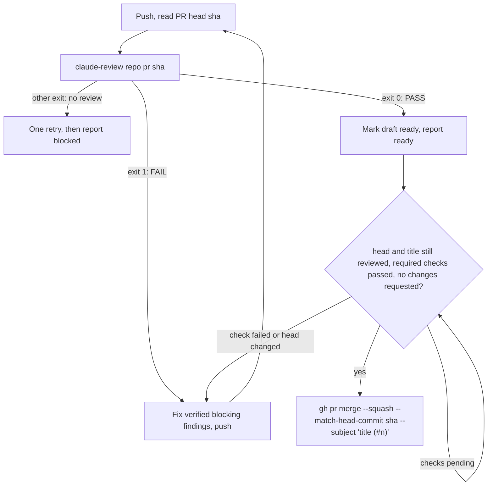
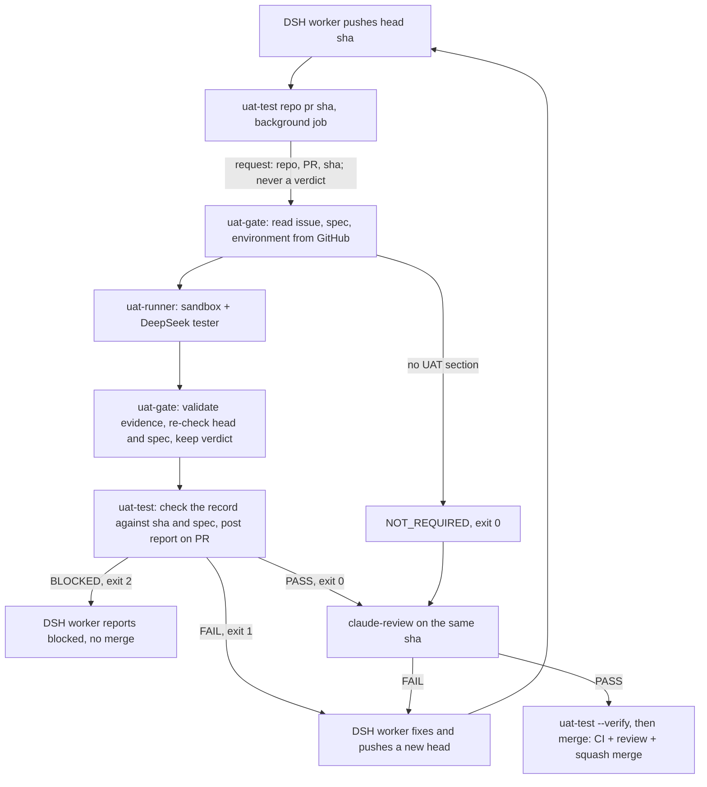

# DSH Superagent on Coolify

> Unofficial integration. This specifically targets Coolify's **Caddy**
> reverse proxy. Traefik labels are different.

## Architecture

```
Browser (HTTPS)
  -> Coolify Caddy proxy :443
    -> dashboard (internal Caddy :8080)
       -> superagent:3083 (socat tunnel to DSH 127.0.0.1:3082)
```

Access is authenticated by DSH itself: the launch-token URL that DSH prints in
the container log mints a signed, `HttpOnly`, `SameSite=Strict` session cookie
(valid 30 days, kept across restarts). Without it the DSH UI and its `/api`
answer 401.

The Superagent management API (`/orchestrator/api/*`) performs no
authentication of its own: it only accepts `Host: 127.0.0.1:3082` or
`localhost:3082` and no foreign `Origin`, trusting that only local processes
reach it. The inner proxy rewrites those headers so the browser panel works,
and therefore must authenticate those requests itself. Before forwarding, it
asks DSH whether the request carries a valid session cookie (`forward_auth`
to `GET /`, which DSH answers with 200 or 401), and it rejects cross-site
requests by their `Sec-Fetch-Site` header. Other DSH UI traffic keeps the
public Host, which `--trusted-host` allows.

## 1. Configure Coolify

Create a Git-backed Docker Compose Application referencing `compose.yaml`.
Keep Compose deployment in **normal/managed mode**, not Raw, so Coolify can
connect the dashboard service to its proxy and generate the Caddy route.

In Coolify **Domains**, assign **one** HTTPS domain, e.g. `https://superagent.example.com`,
to the **`dashboard`** service on **internal port `8080`**, or let Coolify
generate one from its wildcard domain. Do **not** attach the domain to
`superagent`. `compose.yaml` declares `SERVICE_URL_DASHBOARD_8080` on the
dashboard (the suffix selects port 8080), and Coolify derives
`SERVICE_URL_DASHBOARD` (for `--public-url`) and `SERVICE_FQDN_DASHBOARD`
(for `--trusted-host`) from its domain, so there is nothing to keep in sync.
After the first deploy, check under **Environment Variables** that
`SERVICE_FQDN_DASHBOARD` is the bare hostname: older Coolify
versions include the scheme there, which DSH refuses at startup
(`trustedHosts entry … is not a bare host[:port] authority`).

Configure Environment Variables:

| Variable | Description |
| --- | --- |
| `DEEPSEEK_API_KEY` | Model provider secret (runtime only) |
| `GH_TOKEN` | GitHub classic PAT for dedicated agent account (runtime only) |
| `GITHUB_REPOSITORY` | e.g. `ForkbombEu/credimi-attestbook` |
| `ANTHROPIC_API_KEY` or `CLAUDE_CODE_OAUTH_TOKEN` | Claude Code credential for the PR reviewer (runtime only); set one. The subscription token comes from `claude setup-token` |
| `SUPERAGENT_REVIEWER_MODEL` | Optional. Claude Code reviewer model: an alias such as `opus` or `sonnet`, or a full model id; empty uses Claude Code's default for the account |
| `SUPERAGENT_REVIEWER_EFFORT` | Optional. Claude Code reviewer effort: `low`, `medium`, `high`, `xhigh` or `max`; empty uses Claude Code's default (`high`) |
| `SUPERAGENT_UAT_ENABLED` | Optional, `false` by default. `true` turns on [user acceptance tests](#5-user-acceptance-tests), run by the `uat-gate` and `uat-runner` services, which start only with `COMPOSE_PROFILES=uat`; it needs `SUPERAGENT_UAT_GATE_TOKEN` (32+ random characters, shared with `uat-gate`). No GitHub App is needed; the other `SUPERAGENT_UAT_*` settings are in [`.env.example`](.env.example) |
| `COMPOSE_PROFILES` | Optional. `uat` starts the UAT services (`uat-gate`, and the privileged `uat-runner`); leave it unset while UAT is off. Set it together with `SUPERAGENT_UAT_ENABLED=true` |
| `SUPERAGENT_GITHUB_ALLOWED_USERS` | Optional. GitHub logins that may ask for work, comma- or space-separated, e.g. `matteo-cristino` |
| `SUPERAGENT_EXECUTOR_PROVIDER` | Optional. Executor model provider id, e.g. `deepseek-official` |
| `SUPERAGENT_EXECUTOR_MODEL` | Optional, required with the provider. Executor model id, e.g. `deepseek-flash` |
| `SUPERAGENT_EXECUTOR_REASONING_EFFORT` | Optional. Executor reasoning effort; empty uses the model default |
| `SUPERAGENT_MAX_WORKERS` | Optional. Tickets worked on at the same time, 1–16 (panel default 3) |

Provider and model ids are the ones the panel's model fields accept; the
panel shows the DSH default as `provider / model`.

**Security**: whoever can read the container log can read the launch-token
URL and open the UI. The DSH workers execute code and have repository
credentials. Do not directly publish 3082, 3083 or 8080.

## 2. Deploy, validate and open

Deploy the app from Coolify. When Caddy routes are ready:

```bash
# All must be HTTP 401 without the DSH session cookie:
curl -I https://superagent.example.com/
curl -i -H 'x-orchestrator-request: 1' https://superagent.example.com/orchestrator/api/state
curl -i -X POST -H 'content-type: application/json' -d '{}' https://superagent.example.com/api/session/list
```

A 403 from the last request means DSH does not trust the Host: open the
dashboard through its Coolify domain, and redeploy after changing that domain.

Open the launch URL from the `superagent` service log in Coolify, e.g.

```
dsh web: https://superagent.example.com/?token=...
```

DSH sets the session cookie and redirects to `/`. The token changes on every
restart, but the cookie stays valid, so the log URL is only needed for a new
browser or after 30 days.

## 3. Superagent configuration

On every start, `scripts/superagent-configure` waits for DSH and saves these
settings through the management API, so a new deployment starts configured:

| Setting | Value |
| --- | --- |
| Sources > GitHub > Repository | `$GITHUB_REPOSITORY` |
| Sources > GitHub > Agent GitHub CLI | `/usr/local/bin/gh-agent` |
| Eval > On each Source > GitHub accounts that may originate work | `$SUPERAGENT_GITHUB_ALLOWED_USERS`, when set |
| Execution > Executor model | `$SUPERAGENT_EXECUTOR_PROVIDER`, `$SUPERAGENT_EXECUTOR_MODEL`, `$SUPERAGENT_EXECUTOR_REASONING_EFFORT`, when set |
| Execution > Concurrent Tickets | `$SUPERAGENT_MAX_WORKERS`, when set |
| Execution > Prepare command | `/usr/local/bin/prepare-worktree.sh` |
| Prompts > Delivery requirements | [`prompts/delivery.md`](prompts/delivery.md): the Claude Code review and merge procedure below, followed by [`prompts/delivery-uat.md`](prompts/delivery-uat.md) when `SUPERAGENT_UAT_ENABLED` is `true` |

These values win over panel edits: change them in Coolify and redeploy. An
unset optional variable leaves its setting to the panel. The Ticket directory
root stays empty, which already means `/home/agent/.dsh/state/superagent/work`.
The script logs each save, or the reason a save was refused, with the
prefix `superagent-configure:` in the `superagent` service log.

Configure the rest in the panel: prompts and a review
policy appropriate for your project. Default proactive accept mode `observe`
still accepts explicit requests from allowlisted users; don't enable automatic
inferred work prematurely.

## 4. Claude Code review and automatic merge

DeepSeek implements and opens the PR as the agent account. Before merging, the
DeepSeek worker runs [`claude-review`](scripts/claude-review) on the PR's exact
head commit, then follows [`prompts/delivery.md`](prompts/delivery.md):



`claude-review` is a command rather than DSH's official Claude Code subagent
tool because dsh-superagent limits its workers to a fixed list of tools
(`WORK_TOOLS` in its `src/app/sessions.ts`), which hides that tool from them.
The command:

- checks that the sha is both the PR's head on GitHub and the checked-out
  commit, and reads the PR's title and base branch itself;
- runs the Claude Code CLI (`@anthropic-ai/claude-code`, installed in the
  image) with the fixed review task in
  [`claude-code/review-prompt.md`](claude-code/review-prompt.md), so DeepSeek
  cannot change what Claude is asked or conclude for it;
- gives Claude this PR's earlier reviews: every summary, and the latest review
  in full with its fix plan. Claude first re-checks the earlier blocking
  findings. A later round may only block on an unresolved finding, a problem
  the new changes introduced, a failing check, or a security, data-loss or
  correctness defect that can actually be triggered, and a recurring kind of
  problem gets one structural fix instead of another patch;
- accepts only an answer ending in `VERDICT: PASS|FAIL` and
  `REVIEWED_SHA: <that sha>`, with a Summary, a Review and a Fix plan written
  for DeepSeek (files, code sketches, tests with expected results, commands to
  run). It posts only the Summary on the PR, as a
  `**Claude Code review** of <sha>: PASS|FAIL` comment, the record of each
  round, and keeps the whole answer in the volume under
  `~/.local/state/claude-review/<owner>/<repo>/pr-<n>/`, as the worker's input
  and the next review's history;
- exits 0 for PASS, 1 for FAIL, 2 when there is no usable review (nothing
  posted, for example a timeout after 30 minutes) and 3 when the comment could
  not be posted;
- reads the Claude credential, `SUPERAGENT_REVIEWER_MODEL` and
  `SUPERAGENT_REVIEWER_EFFORT` from `/run/superagent-secrets/claude-review.json`,
  which the entrypoint writes to the container's tmpfs: DSH strips variables
  named `*_KEY`/`*_TOKEN` from worker shells.
- Commit messages and PR titles follow
  [Conventional Commits](https://www.conventionalcommits.org/en/v1.0.0/).
  Claude Code blocks a PR whose title does not, and only notes a
  non-conforming commit message: the squash commit on the base branch takes
  its subject from the reviewed title.
- Each PR description names the issues it resolves with `Closes #<n>`, so
  GitHub closes them when the PR merges; an issue a PR only advances gets
  `Refs #<n>` and stays open.
- **Issues run in dependency order without a person.** An issue lists its
  prerequisites on one line of its description, `Depends on #<a>, #<b>`. Its
  worker checks them first; if any is not closed as completed, it changes
  nothing and reports blocked with `Waiting for dependencies: …`.
  [`superagent-dependencies`](scripts/superagent-dependencies), started by the
  entrypoint, checks such tickets every minute and retries each one, as the
  panel's **Retry** does, once all the issues it waits for are closed as
  completed. It reads issue states from GitHub itself, so no worker or main
  Session message is needed after a merge. It retries a ticket at most three
  times, and logs (with the prefix `superagent-dependencies:`) a ticket that
  waits for an issue closed as not planned. Issues with no open prerequisites
  run in parallel, up to `SUPERAGENT_MAX_WORKERS`. Each issue must mention
  `@forkboteu` and be opened by an allowed account, so that it becomes a
  Ticket; it must not ask to wait for a person.
- A lost completion wake-up cannot strand a UAT ticket. Before a worker waits
  for its detached UAT job, it records `Waiting for UAT: PR #<n> at <sha>`.
  [`superagent-uat-recovery`](scripts/superagent-uat-recovery) asks the
  trusted gate for that exact run every minute and retries the blocked ticket
  once the run has a durable verdict. The resumed worker reads that result and
  continues with the reviewer, fix, or block path; it does not reset the UAT
  counter. A ticket gets at most three recovery retries for one SHA.
- At most three failing reviews per PR; then the worker reports blocked and
  leaves the PR unmerged. It never uses `--admin`, auto-merge, or changes
  branch protection; a merge GitHub refuses is reported, not retried.
- Claude Code runs in a temporary checkout of the reviewed commit, deleted
  afterwards, with `--permission-mode dontAsk` and the managed policy
  [`claude-code/managed-settings.json`](claude-code/managed-settings.json),
  installed as `/etc/claude-code/managed-settings.json`. It may read files, run
  read-only `git` and inspection commands, install dependencies and run tests,
  type checks and builds (`npm`, `npx`, `node`, `pnpm`, `bun`, `mise`, `make`,
  `pytest`), and read the PR, issues and CI runs with read-only `gh`
  subcommands. File edits, `git commit`/`push`, `gh api` and every `gh`
  subcommand that writes are denied, and the repository's own `.claude/`
  settings, hooks and MCP servers cannot widen that. Running the PR's tests
  runs the PR's code with the agent account's credentials available, as the
  DeepSeek worker already does: the `gh` limits stop Claude from writing, not
  code it executes.
- The merge uses the agent account's existing `gh`, so the account needs
  merge rights. Enable squash merging in the repository, and require status
  checks in branch protection for the CI gate to mean anything; do not require
  approving reviews, which the agent account cannot give itself.
- **Toolchains come from the repository's `mise.toml`.** The image ships
  [mise](https://mise.jdx.dev/) instead of fixed runtimes. The prepare command
  runs `mise install` in every new Ticket directory and `claude-review` in every
  review checkout, so the worker and Claude Code use the versions the
  repository pins (for example Bun and Node); mise's shims come first on
  `PATH`. Outside such a repository, `node` is the image's own. Installed
  versions stay in the `superagent_home` volume. Tool versions apply in any
  directory; mise runs a `mise.toml`'s `[env]`, tasks and hooks only in the
  Ticket directories, the repository checkout and the review checkouts.
- These are prompt instructions to the DeepSeek worker, not a guarantee
  enforced by code: the worker could merge without a review. Branch protection
  is the enforced part (CI, no force pushes to the base branch). The Claude Code
  review and the [user acceptance tests](#5-user-acceptance-tests) are
  independently executed, but their verdicts are enforced by the Delivery
  requirements: their PR comments are written with the agent's own token, so
  they are a record, not a security gate.

### Target repository setup

Start each repository the deployment works on from
[`templates/AGENTS.md`](templates/AGENTS.md): copy it to the repository root
and fill in its **Project** section. It states the merge, commit and
pull-request rules above, which the repository's own instructions must not
contradict, and how to write issues so they run without a person (the
`@forkboteu` mention, one PR per issue, `Depends on` lines, no holds). To fill
a backlog, ask any coding agent to read that `AGENTS.md` and
`docs/specification.md` and open the issues, with your `gh` account.

One deployment works on one repository (`GITHUB_REPOSITORY`); use a separate
Coolify application for each further repository.

## 5. User acceptance tests

Optional. When an issue has a `## User Acceptance Tests` section (format in
[`templates/AGENTS.md`](templates/AGENTS.md)), an independent DeepSeek tester
runs every scenario against the running pull request at its exact head commit,
before the Claude Code review, and the worker merges only after a UAT pass
that still holds for the head it merges. Without the section, the result is
`NOT_REQUIRED` and says that nothing was tested.

UAT follows the same trust model as the Claude Code review. DSH Superagent stays
the only orchestrator: its worker runs [`uat-test`](scripts/uat-test) as a
background job, exactly like `claude-review`, and the Delivery requirements
([`prompts/delivery-uat.md`](prompts/delivery-uat.md)) tell it what each verdict
means. The tests run independently of the worker, in containers it cannot
reach, and their result is checked against the exact commit and the issue's
current UAT spec, but nothing on GitHub enforces the verdict: there is no
GitHub App, no `superagent/uat` check and no GitHub Actions workflow.



| Function | Owner |
| --- | --- |
| Tickets, dependencies, coder, tester and reviewer order, retries, merge | DSH Superagent (`prompts/delivery.md`, `prompts/delivery-uat.md`) |
| Asking for UAT of a head, checking and reporting its result | [`uat-test`](scripts/uat-test), in the worker |
| Reading the PR, issue, spec and policy; keeping runs, verdicts and failure budgets | `uat-gate` ([`uat/gate.py`](uat/gate.py), [`uat/controller.py`](uat/controller.py)) |
| Running the PR's code and the tester | `uat-runner`, an isolated Docker daemon |
| Code review | [`claude-review`](scripts/claude-review), which also refuses a head whose UAT has not passed |
| Build and unit tests | the project's own CI, unchanged (GitHub Actions or not) |

`uat-test` exits like `claude-review`: 0 for `PASS` or `NOT_REQUIRED` of exactly
the given SHA, 1 for `FAIL` (back to the coder), 2 for `BLOCKED` (one retry when
the runner or gate is at fault, else blocked, never merged), any other status
for no verdict. It accepts the gate's record only for that exact SHA, PR and
repository, and a pass only while it still holds for the PR's current head and
its issue's current spec. It posts the report on the PR, once per run, as
`claude-review` posts its review. Any new commit is a new head: both earlier
results stop counting, and the head gets UAT and then a review again. Before
merging, the worker runs `uat-test --verify` on the head it merges, then the
existing merge procedure applies unchanged: a passing review of that head and
title, every required CI check passed, no review requesting changes, and
`gh pr merge --squash --match-head-commit`.

### Services and trust boundaries

[`compose.yaml`](compose.yaml) adds two services next to `superagent`:

- **`uat-gate`** ([image](uat/gate/Dockerfile)) holds a GitHub token it only
  reads with (`SUPERAGENT_UAT_GITHUB_TOKEN`, a read-only token for contents,
  issues and pull requests, or else the deployment's `GH_TOKEN`), the tester's
  DeepSeek key and a SQLite database on its own volume (`uat_gate_state`: runs,
  at most one active run per PR, failure budgets and each run's kept files). It
  writes nothing on GitHub. Its API, on the internal network only, answers
  requests from the `superagent` service alone and with the shared
  `SUPERAGENT_UAT_GATE_TOKEN`. The token lets the worker ask, never decide: a
  request names a repository, PR and head SHA and, when the ticket started from
  an issue, that issue (`uat-test` takes it from DSH's
  `DSH_SUPERAGENT_GITHUB_NUMBER`), and nothing else. The gate pins that issue to
  the PR once it is bound (it exists, is not a pull request and the PR closes
  it; a request naming another issue first gets `FAIL` and pins nothing) and
  then refuses any other; the PR must keep closing it, so rewriting
  `Closes #<n>` cannot swap its UAT for another issue's. The
  gate re-reads everything the run is bound to from GitHub (the PR head, the
  issues its `Closes #<n>` lines name, the spec hash, `.superagent/uat.yaml`) and
  checks it against its own policy. It runs no pull request code, and its GitHub token
  reaches no container: it is used for API reads and, through the environment
  of a single `git fetch`, for the checkout, and is redacted from kept files.
- **`uat-runner`** is a Docker-in-Docker daemon, privileged as Docker in
  Docker requires, reachable only on the separate `uat` network and only with
  the TLS client certificate the gate holds. The PR's setup and start commands
  and the tester run in its containers: unprivileged, without capabilities,
  with memory, CPU and process limits, on per-run networks, never with the host
  Docker socket or a GitHub token, so the tester cannot push, merge or change
  the PR. Neither it nor its containers can reach `superagent` (DSH's
  management API) or the dashboard.
- **`superagent`** gets only the gate URL and the request token.

Runs are keyed by repository, PR, head, the ticket's issue, spec hash,
environment and a fingerprint of the UAT policy (environments, preview URL,
hosts, revision path, credentials, model), and `uat-test --verify` looks up
exactly the key a new request would use: a key that
passed, failed or needs no UAT is answered again rather than re-run, a newer
head replaces an active run (which becomes `STALE`), and a run the gate lost
in a restart is run again once, then `BLOCKED`. A PR gets three failing rounds
by default (`SUPERAGENT_UAT_MAX_FAILED_ROUNDS`), separately from its three
failed reviews, counted in the gate's database, so restarts of either service
do not reset them; deleting the `uat_gate_state` volume does.

The tester is DeepSeek Harness 0.2.1-rc.3 (`dsh --profile superagent-uat --json -`,
prompt on stdin, [profile](uat/tester/profile.patch.yml) seeded from the
headless template and checked at image build) in a disposable container, a
fresh session per attempt. Its [prompt](prompts/uat-tester.md) treats the
scenarios as data. A run passes only when DSH completed its turn, the final
answer is a [result](uat/result.schema.json) that repeats the trusted
metadata, covers exactly the spec's scenarios and cites evidence files that
the tester's executed commands produced in a fresh directory
([`uat/result.py`](uat/result.py)): every cited file written by a completed
`curl` or `chromium` command that addresses only the application (to the file
itself or through a `tee`), or copied from its log under `/app-logs/`, and by
no other command (no `echo`, `sed` or script, comments ignored as the shell
ignores them). A request's URLs are curl's own (its positional words and
`--url`), never values of other options such as headers or bodies; options
that reroute it (`-x`, `--resolve`, `--connect-to`, `-K` ...) are refused.
Every HTTP status the scenario reports (`HTTP 201, then 200`, `POST returned
201`, `404 Not Found`, or a bare `201, 200` when its evidence holds HTTP
responses; not quantities, ids, ports or durations such as `500 records`,
`id 404`, `port 3000`, `200 ms`) must be in the status lines of
its own cited responses. Anything else (timeout, crash, malformed answer,
missing, fabricated or unrelated evidence, a PASS without executed commands)
is `BLOCKED`.
DSH's own transient model errors are retried once.

| Verdict | `uat-test` | Merge | Counts as a failing round |
| --- | --- | --- | --- |
| `PASS` | 0 | after a review pass, while it holds | no |
| `NOT_REQUIRED` | 0 | after a review pass, while it holds | no |
| `FAIL` (a scenario fails, or the PR cannot be set up, started or configured) | 1 | no | yes |
| `BLOCKED` (cannot run, invalid UAT section, environment not allowed, budget used up, runner or gate failure) | 2 | no | no |
| `STALE` (head, spec, environment, the ticket's issue or the UAT policy changed) | asks for a new run | no | no |

Verdicts are plain records in the gate (verdict, exact head SHA, spec hash,
environment, report), independent of how they reach GitHub; a trusted
publisher, such as a GitHub App for both UAT and the Claude Code review, can
be added later on top of them.

### Local environment

`Environment: local` (the default) builds and starts the PR on the runner
from the repository's `.superagent/uat.yaml` ([schema](uat/config.schema.json)):
`mise install` and `setup` run with network access, then `start` runs on an
internal network whose only exit is an [allowlisting proxy](uat/proxy.py)
that admits the model API alone; the tester shares the application's network
namespace, so `ready: http://127.0.0.1:<port>/…` works for both. Setup and the
application run as their own unprivileged uid in a copy of the checkout whose
committed files belong to the gate and are read-only, in directories where
anyone may add files but only the owner may delete or rename them: they can
install dependencies and build anywhere, but cannot change, delete or replace
a committed file, so nothing they build or run comes from altered source (a
setup that tries fails, and the check after setup and after the test turns
any changed committed file into `FAIL`). The tester reads the untouched
checkout. Every container, network and volume of a run carries the label
`superagent-uat.run=<run>`; they are removed by that label, tester attempts
included, after the run, when a newer head replaces it, before the run is
retried, and on gate restarts. The application must run entirely inside its
container (no Docker,
no outside services at run time).

### Preview environment

`Environment: preview` tests the PR's preview deployment instead. Everything
about it comes from the gate's policy: `SUPERAGENT_UAT_PREVIEW_URL` (a
template, `{pr}` for the PR number), `SUPERAGENT_UAT_PREVIEW_ALLOWED_HOSTS`
(`host` or `*.domain`, space-separated) and `SUPERAGENT_UAT_PREVIEW_REVISION_PATH`,
a path the deployment answers with the commit it runs; add `preview` to
`SUPERAGENT_UAT_ENVIRONMENTS`. Before testing, the gate requires the readiness
path (`readiness_path` in `.superagent/uat.yaml`, default `/`) to answer and the
revision path to name exactly the head SHA: the whole body, or the one
`revision`, `sha`, `commit`, `commit_sha` or `git_sha` field of a JSON object
naming no other commit. An older commit or an error is asked again until
`SUPERAGENT_UAT_PREVIEW_READY_TIMEOUT_SECONDS` while the deployment
propagates; a stale, ambiguous, unavailable or disallowed
preview, or a redirect off the allowed hosts, is `BLOCKED`. The tester reaches
only the model API and the preview host. Optional test credentials
(`SUPERAGENT_UAT_PREVIEW_CREDENTIALS`, a JSON object of values of 8+
characters) are a read-only file for the tester and are redacted from kept
files and reports. Point previews only at staging data: the tester names what
it creates with a per-run prefix and deletes it, but never test against
production.

### Setup

1. In Coolify > Environment Variables, set `COMPOSE_PROFILES=uat` (Docker
   Compose reads it from the environment file Coolify deploys with, and starts
   `uat-gate` and `uat-runner`, which have `profiles: [uat]`),
   `SUPERAGENT_UAT_ENABLED=true`, `SUPERAGENT_UAT_GATE_TOKEN`
   (`openssl rand -hex 32`) and the policy variables you need
   ([`.env.example`](.env.example)); optionally `SUPERAGENT_UAT_GITHUB_TOKEN`, a
   fine-grained token with read access to the repository's contents, issues and
   pull requests, so the gate does not use the agent's `GH_TOKEN`. Redeploy: the
   Delivery requirements gain the UAT step and the worker gets `uat-test`.
2. Check the deployment log, or Coolify's service list: `uat-gate` and
   `uat-runner` must be running. Without `COMPOSE_PROFILES=uat` only
   `superagent` and `dashboard` start, and with `SUPERAGENT_UAT_ENABLED=true`
   every `uat-test` then ends without a verdict and nothing merges.
3. Coolify must allow the privileged `uat-runner`; without it, every UAT run
   ends `BLOCKED` (the runner is unavailable) and nothing merges.
4. Keep the required CI checks in branch protection as they are. Do not
   require a `superagent/uat` check: nothing publishes it.

To turn UAT off, set `SUPERAGENT_UAT_ENABLED=false`, remove `COMPOSE_PROFILES`
and redeploy, then stop the `uat-gate` and `uat-runner` containers that are
still running (Compose leaves services of an inactive profile alone:
`docker compose --profile uat stop uat-gate uat-runner`). Their volumes keep
the gate's runs and failure budgets for a later re-enable. A deployment that
had UAT on before this change adds `COMPOSE_PROFILES=uat` when it updates.

### Moving from the GitHub App version

The previous version published a required `superagent/uat` check through a
GitHub App (commit `4385d6f`). This version never publishes it, so a branch
protection rule or ruleset that still requires it makes every pull request
unmergeable. Before enabling this version:

1. Remove `superagent/uat` from the required status checks of the default
   branch (branch protection or ruleset), keeping the CI checks required.
   Nothing changes branch protection automatically.
2. Deploy with `SUPERAGENT_UAT_ENABLED=true` instead of `SUPERAGENT_UAT_APP_ID`,
   and remove `SUPERAGENT_UAT_APP_ID`, `SUPERAGENT_UAT_APP_PRIVATE_KEY`,
   `SUPERAGENT_UAT_INSTALLATION_ID` and `SUPERAGENT_UAT_CHECK_NAME` from Coolify.
3. The gate's database carries over: its runs and failure budgets stay. Earlier
   `superagent/uat` check runs stay on their commits as history; open PRs get
   their next result from `uat-test`.
4. The GitHub App can be uninstalled, or kept for a future trusted publisher.

### Troubleshooting

- `uat-test` prints the verdict, each failing scenario with expected,
  observed and reproduction steps, the reasons for `BLOCKED` and the UAT run
  id, and posts the same report on the PR. `uat-test --artifact <run id> <path>`
  prints a kept file: `outcome.json`, `setup.log`, `app-logs/app.log`,
  `proxy.log` (every allowed and denied connection), and per attempt the
  prompt, the DSH NDJSON trace and the evidence (`tester/attempt-1/…`,
  `tester-work/attempt-1/artifacts/…`), with the DeepSeek key, the gate's
  GitHub token and test credentials redacted.
- `uat-test` exits 3 when the gate is unreachable for five minutes, refuses
  the request (wrong token, repository or old head), returns a record that is
  not for the given SHA, or the PR comment could not be posted. The
  `uat-gate` log has each request and run (prefix `superagent-uat:`);
  `GET /healthz` says whether the gate is configured.
- `claude-review` exits 4 when UAT has not passed for its SHA: run `uat-test`
  for that SHA first.
- `BLOCKED` with "the UAT runner is unavailable": `uat-runner` is down, not
  privileged, or its client certificate did not reach the gate (see the
  `uat-gate` log at start).

### Limits

- The UAT verdict, like the Claude Code review, is enforced by the Delivery
  requirements and by `claude-review`'s own check, not by GitHub: a worker that
  ignored them could merge without UAT. Branch protection still enforces CI.
- The issue a ticket started from reaches the gate only through the worker's
  request (`DSH_SUPERAGENT_GITHUB_NUMBER`): DSH keeps it in its own state
  database and management API, both writable by the worker's user, and posts
  on GitHub with the same token the worker holds, so nothing the gate can read
  records it beyond the worker's reach. Once pinned it cannot change, but a
  worker that leaves it out of its first request, and edits `Closes #<n>` to
  an issue without UAT, is tested against that issue alone; the original issue
  then stays open after the merge. Binding it authoritatively needs DSH itself
  to publish the ticket's origin where the worker cannot write, a deferred
  improvement together with GitHub-enforced merges.
- The tester is a model: hostile output from the application could mislead
  it. The evidence rules stop answers without executed commands or evidence,
  not a tester convinced by a lying application.
- The tester's DeepSeek key is in its container's `dsh` process; DSH keeps it
  out of the tester's shell environment, but a process of the same user could
  read it from `/proc`. Its egress reaches only the model API and the
  application, and kept files are redacted.
- `uat-runner` is privileged: a container escape from a sandbox reaches the
  runner and, through it, the host. Run the deployment on a host dedicated to
  it.
- Without `SUPERAGENT_UAT_GITHUB_TOKEN`, the gate holds the agent's `GH_TOKEN`,
  which can write; it only reads with it.
- The issue is the one the PR closes (`Closes #<n>`); the Claude Code review
  reads the issue too. One PR may close at most one issue with UAT.
- An issue edit after a pass is caught when `uat-test --verify` runs before
  the merge, not earlier.
- Setup commands run the PR's code with network access on the runner, as CI
  does, but with no credential.

Run the tests with `python3 -m unittest discover -s uat/tests -t .`; those
that need Docker build the images and drive real DSH against a scripted model
(`SUPERAGENT_UAT_SKIP_DOCKER_TESTS=1` skips them).

## 6. Operational notes and limitations

- Keep existing service name `superagent` and volume `superagent_home` when
  migrating from the previous package. Docker Compose/Coolify may still
  rename/prefix volume names; **confirm the deployed volume before migration**.
- `superagent:3083` exists on the internal Compose network only. The outer
  Coolify Caddy proxy should route only to `dashboard:8080`.
- DSH itself uses `--public-url` and `--trusted-host` to support the external
  URL. If your pinned DSH CLI version does not recognize those flags, you may
  need to upgrade its version rather than removing the host security check.
- The management API's loopback check is intentionally rewritten by the inner
  proxy, which checks the DSH session cookie instead. A service connected to
  the same internal Docker network can still reach `superagent:3083` directly
  and bypass that check; isolate the deployment from untrusted containers.
- The image build caches npm/pnpm downloads in BuildKit cache mounts on the
  build server. Keep **Advanced > Build cache** on **Use Docker build cache**:
  "Rebuild from scratch" / "Force deploy (without cache)" skip both the layer
  cache and these mounts. Unchanged layers (apt, `dsh` install) are reused
  entirely; the cache mounts speed up the `dsh` install when its layer reruns.
  Because the upstream clone layer is cached too, use a forced rebuild to pick
  up new `dsh-superagent-prototype` commits on `main`.

References:
- https://coolify.io/docs/applications/builds/docker-compose
- https://github.com/deepseek-ai/dsh-superagent-prototype/blob/main/src/app/http.ts
- https://github.com/deepseek-ai/deepseek-harness/blob/master/docs/user/guide/public-deployments.md
